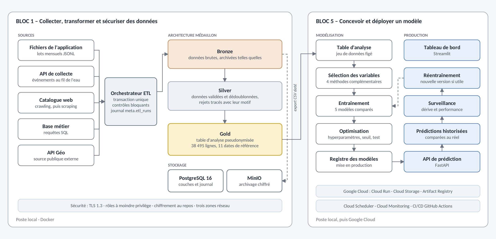

# Attrition des abonnés - de la collecte des données au modèle en production

Projet réalisé dans le cadre de la certification *Ingénieur en science des données* (RNCP39586), à Nantes Ynov Campus.

Un service par abonnement perd chaque mois une partie de ses clients. Ce projet cherche à anticiper ces départs. Il couvre toute la chaîne : collecter des données dispersées entre plusieurs outils, les transformer en une table d'analyse fiable et protégée, puis construire un modèle qui repère les abonnés les plus susceptibles de résilier, et le maintenir en production.

Le projet est organisé en deux parties, qui correspondent à deux blocs de compétences de la certification.

| Partie | Objectif | Résultat |
| --- | --- | --- |
| [**Bloc 1**](bloc1/README.md) – Collecter, transformer et sécuriser des données | Construire une chaîne de collecte et de préparation des données | Une table d'analyse de 38 495 lignes, pseudonymisée, actualisée automatiquement |
| [**Bloc 5**](bloc5/README.md) – Concevoir et déployer un modèle | Prédire la résiliation à trente jours et mettre le modèle en production | Plus de la moitié des départs repérés en contactant 10 % des abonnés |

---

## Vue d'ensemble 



Le passage d'un bloc à l'autre se fait par un seul point de contact : le Bloc 1 exporte sa table d'analyse dans un fichier CSV daté (`bloc1/exporter_gold.py`), que le Bloc 5 utilise comme jeu de données. Ce fichier fige les données ayant servi à chaque entraînement.

## Organisation du dépôt

```
attrition-abonnes/
├── bloc1/                  Chaîne de collecte, de transformation et de sécurisation
│   ├── api_collecte/       API de collecte des événements
│   ├── passerelle/         Passerelle HTTPS (Nginx)
│   ├── sql/                Schéma, contraintes, rôles et règles d'accès
│   ├── site_catalogue/     Catalogue web lu par le crawler
│   ├── tests/              Tests automatisés
│   └── journaux/           Résultats des exécutions et des recettes
├── bloc5/                  Modèle de prédiction et mise en production
│   ├── gcp/                Mise en place sur Google Cloud
│   └── tests/              Tests automatisés
└── .github/workflows/      Chaîne d'intégration et de déploiement continus
```

## Technologies

| Domaine | Outils |
| --- | --- |
| Langages | Python 3.12, SQL |
| Stockage | PostgreSQL 16, MinIO (stockage objet compatible S3) |
| Collecte et transformation | requests, BeautifulSoup, pandas, psycopg2 |
| Apprentissage automatique | scikit-learn, XGBoost |
| Services | FastAPI, Streamlit, Nginx |
| Conteneurisation | Docker, Docker Compose |
| Intégration et déploiement continus | GitHub Actions |
| Cloud | Google Cloud : Cloud Run, Cloud Storage, Artifact Registry, Cloud Scheduler, Cloud Monitoring |

---

## Démarrage rapide

### Prérequis

- Windows 10 ou 11, avec PowerShell
- Python 3.12
- Docker Desktop

### Installation

Un seul environnement Python sert aux deux blocs :

```powershell
git clone https://github.com/messanh0139/attrition-abonnes.git
cd attrition-abonnes
python -m venv .venv
.venv\Scripts\Activate.ps1
pip install -r bloc1\requirements.txt -r bloc5\requirements.txt
```

### Exécution

1. **Bloc 1** : suivre la partie « Installation » du [README du Bloc 1](bloc1/README.md) (certificats, secrets, démarrage des services), lancer la chaîne, puis exporter la table d'analyse avec `python exporter_gold.py`.
2. **Bloc 5** : suivre le [README du Bloc 5](bloc5/README.md) pour entraîner le modèle, puis lancer l'API et le tableau de bord.

### Vérifier que tout fonctionne

```powershell
cd bloc1 ; python -m pytest -q ; cd ..      # 12 tests
cd bloc5 ; python -m pytest -q ; cd ..      # 19 tests
```

Les tests du Bloc 1 nécessitent que les services Docker et le catalogue local soient démarrés. Ceux du Bloc 5 utilisent un jeu de données synthétique et fonctionnent sans aucun service.

---

## Qualité et sécurité

**Des résultats vérifiables.** Chaque affirmation du projet repose sur une recette rejouable, dont les résultats sont conservés dans `bloc1/journaux/` et `bloc1/preuves_finales/` :

| Vérification | Résultat |
| --- | --- |
| Tests automatisés | 12 (Bloc 1) et 19 (Bloc 5), tous réussis |
| Recette de sécurité (droits, contraintes, chiffrement) | 14 essais conformes |
| Recette de l'architecture en trois zones | 15 essais conformes |
| Sauvegarde chiffrée et restauration | 520 922 lignes comparées, aucune différence |
| Planification | 36 exécutions automatiques réussies sur six journées |

**Des données protégées.** Les données des clients sont simulées : aucune donnée personnelle réelle n'est manipulée. La table d'analyse est en outre pseudonymisée, et seule une source publique réelle est utilisée, l'API Géo de l'État.

**Rien de sensible dans le dépôt.** Les secrets, certificats, clés de chiffrement, données et sauvegardes restent sur le poste de travail et ne sont jamais versionnés (voir `.gitignore`). Le déploiement sur Google Cloud s'authentifie par fédération d'identité, sans clé stockée dans le dépôt.

## Intégration et déploiement continus

À chaque modification du Bloc 5, GitHub Actions exécute les tests automatisés. Une fois le projet Google Cloud configuré, la même chaîne entraîne le modèle, le contrôle, le compare au modèle en production, puis déploie l'API, le tableau de bord et le cycle mensuel sur Cloud Run.

---

## Auteur

**KODJO Messanh Yaovi** – Nantes Ynov Campus, certification *Ingénieur en science des données* (RNCP39586).