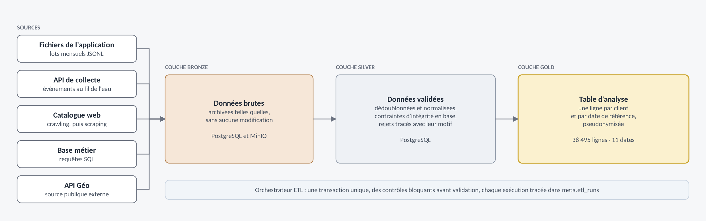

# Bloc 1 – Collecter, transformer et sécuriser des données

Chaîne de collecte et de préparation des données pour l'étude de l'attrition des abonnés d'un service par abonnement.

Ce projet répond au Bloc 1 de la certification *Expert en science des données* (RNCP39586). Il part d'un besoin simple : comprendre ce qui précède la résiliation d'un abonné. Les signaux utiles (baisse d'utilisation, demandes au support, réclamations) sont dispersés entre plusieurs outils. La chaîne les collecte, les contrôle, les transforme et les protège, pour produire une table d'analyse fiable, traçable et pseudonymisée.

Le service étudié est fictif. Les données des clients sont simulées, pour ne manipuler aucune donnée personnelle réelle et pour pouvoir y placer des anomalies connues. Les données territoriales de référence proviennent en revanche d'une source publique réelle, l'API Géo de l'État.

---

## Ce que fait la chaîne 



Le stockage suit le design pattern **médaillon** (bronze, silver, gold) :

- **bronze** conserve chaque donnée telle qu'elle a été reçue, ce qui permet de rejouer un traitement sans collecter à nouveau ;
- **silver** contient des données contrôlées, avec des contraintes d'intégrité en base ;
- **gold** contient la table d'analyse, la seule accessible à l'analyste.

L'orchestrateur exécute toutes les étapes dans une **transaction unique** : si un contrôle échoue, rien n'est écrit, et la base reste dans son état précédent.

## Technologies

| Besoin | Outil |
| --- | --- |
| Base de données relationnelle | PostgreSQL 16 |
| Stockage objet des archives brutes | MinIO (compatible S3), objets chiffrés au repos |
| Collecte et transformation | Python 3.12 (requests, BeautifulSoup, pandas, psycopg2) et SQL |
| Conteneurisation | Docker et Docker Compose |
| Passerelle HTTPS | Nginx, TLS 1.3 uniquement |
| Tests | pytest |
| Planification | Planificateur de tâches Windows (cron sous Linux) |

## Organisation du dossier

| Élément | Rôle |
| --- | --- |
| `generer_donnees.py` | Génère un jeu de données reproductible (5 000 clients, 471 625 événements), avec des anomalies connues |
| `crawl_scrape.py` | Parcourt le catalogue web en respectant `robots.txt`, puis extrait les offres et leurs prix |
| `api_geo.py` | Interroge l'API Géo pour obtenir le code INSEE, le département et la population des communes |
| `etl.py` | Transforme les données de bronze vers silver, puis calcule la couche gold |
| `qualite.py` | Contrôles bloquants et profilage des données |
| `orchestrer.py` | Enchaîne les étapes en une transaction et trace chaque exécution dans `meta.etl_runs` |
| `stockage_objet.py` | Dépose les archives brutes dans MinIO, puis les relit pour vérifier qu'elles sont complètes et chiffrées |
| `exporter_gold.py` | Exporte la table d'analyse en CSV, pour le Bloc 5 |
| `api_collecte/` | API de collecte des événements, en écriture seule dans la couche bronze |
| `passerelle/` | Configuration de la passerelle HTTPS (Nginx) |
| `sql/` | Schéma, contraintes, rôles et règles d'accès à PostgreSQL |
| `site_catalogue/` | Site du catalogue des offres, lu par le crawler |
| `tests/` | Tests automatisés de la chaîne |
| `tests_securite.py`, `recette_architecture.py` | Recettes de sécurité et d'architecture |
| `*.ps1` | Scripts Windows : sauvegarde et restauration, recette des pannes, planification |
| `journaux/`, `preuves_finales/` | Résultats des exécutions et des recettes |

---

## Installation

### Prérequis

- Windows 10 ou 11, avec PowerShell
- Python 3.12
- Docker Desktop

### Mise en place

Depuis la racine du dépôt, créer l'environnement Python commun aux deux blocs :

```powershell
python -m venv .venv
.venv\Scripts\Activate.ps1
pip install -r bloc1\requirements.txt
cd bloc1
```

Générer les certificats TLS et les clés de chiffrement. Le script ne crée que les fichiers manquants, et ne remplace jamais une clé existante :

```powershell
python generer_certificats.py
```

Créer les trois secrets d'administration :

```powershell
Set-Content -NoNewline -Encoding ascii secrets\pg_admin.txt "MotDePasseAdmin"
Set-Content -NoNewline -Encoding ascii secrets\minio_user.txt "minioadmin"
Set-Content -NoNewline -Encoding ascii secrets\minio_password.txt "MotDePasseMinio1"
```

Créer ensuite le fichier de configuration local à partir du modèle :

```powershell
Copy-Item env.ps1.exemple env.ps1
```

Dans `env.ps1`, renseigner les mots de passe des rôles r_etl (`etl-demo`) et r_analyste (`ana-demo`), ainsi que l'identifiant et le mot de passe de MinIO, identiques à ceux des secrets. Puis charger la configuration :

```powershell
. .\env.ps1
```

Démarrer les services, puis définir les mots de passe des rôles PostgreSQL :

```powershell
docker compose --profile minio --profile acces up -d
docker compose exec postgres psql -U postgres -d attrition -c "ALTER ROLE r_etl PASSWORD 'etl-demo'; ALTER ROLE r_analyste PASSWORD 'ana-demo'; ALTER ROLE r_ingestion PASSWORD 'ing-demo';"
```

Les mots de passe indiqués ici sont des valeurs de démonstration, adaptées à un poste de développement dont les ports ne sont ouverts que sur `127.0.0.1`. Ils doivent être changés dans tout autre contexte.

> Les dossiers `secrets/` et `certs/`, ainsi que le fichier `env.ps1`, ne sont jamais versionnés.

## Exécution

Le crawler lit le catalogue sur un petit serveur local. Le démarrer dans une fenêtre séparée, et la laisser ouverte :

```powershell
Start-Process python -ArgumentList "-m", "http.server", "8001", "--bind", "127.0.0.1" -WorkingDirectory "$PWD\site_catalogue"
```

Puis lancer la chaîne complète :

```powershell
python generer_donnees.py      # jeu de données simulé
python orchestrer.py           # collecte, transformation, contrôles, chargement
python api_geo.py              # enrichissement par l'API Géo (accès Internet)
python orchestrer.py           # intégration de l'enrichissement
python stockage_objet.py       # archivage dans MinIO et relecture
python exporter_gold.py        # export de la table d'analyse pour le Bloc 5
```

Une exécution réussie se termine par `"statut": "succes"` et produit 38 495 lignes d'analyse sur 11 dates de référence.

---

## Tests et recettes

| Commande | Ce qui est vérifié | Résultat attendu |
| --- | --- | --- |
| `python -m pytest -q` | Collecte, transformation, absence de fuite d'information future | 12 tests réussis |
| `python tests_securite.py` | Droits de chaque rôle, contraintes d'intégrité, connexions chiffrées | 14 essais conformes |
| `.\sauvegarde_restauration.ps1` | Sauvegarde chiffrée, restauration sur une base distincte, comparaison ligne par ligne | 0 différence |
| `.\recette_pannes.ps1` | Source indisponible, échec en cours de transaction, reprise | Aucune écriture partielle |
| `python recette_architecture.py` | Exposition, contrôle d'accès, isolation des zones, parcours complet | 15 essais conformes |

Les recettes écrivent leurs résultats dans le dossier `journaux/`.

## Architecture de sécurité

L'architecture repose sur trois zones, chacune dans son propre réseau Docker :

| Zone | Réseau | Composants | Exposition |
| --- | --- | --- | --- |
| Accès applicatif | 10.40.10.0/24 | Passerelle HTTPS, API de collecte | Seule la passerelle, en TLS 1.3 |
| Traitements | 10.40.20.0/24 | Orchestrateur ETL en conteneur, catalogue | Aucun port publié |
| Données | 10.40.30.0/24 | PostgreSQL, MinIO | Administration sur `127.0.0.1` uniquement |

Les autres protections :

- **chiffrement** : TLS obligatoire vers PostgreSQL et MinIO, objets MinIO et sauvegardes chiffrés ;
- **moindre privilège** : quatre rôles PostgreSQL, chacun limité à sa mission (l'analyste ne lit que la couche gold) ;
- **pseudonymisation** : la table d'analyse ne contient aucun identifiant direct ;
- **supervision** : journal des exécutions, contrôles bloquants, rejets tracés avec leur motif.

Deux modes de déploiement sont prévus :

- **développement** : les ports d'administration sont publiés sur `127.0.0.1`, pour les outils du poste ;
- **production** : ces ports ne sont plus publiés, et seule la passerelle HTTPS reste exposée.

```powershell
# Passage en mode production, recette, puis retour en mode développement
docker compose --profile traitements build
docker compose --profile traitements up -d catalogue
docker compose -f docker-compose.yml -f docker-compose.production.yml --profile minio --profile acces up -d
python recette_architecture.py
docker compose --profile minio --profile acces up -d
```

## Planification

```powershell
.\planifier.ps1 -Recette        # une exécution par minute, pour un essai rapide
.\planifier.ps1 -Horaire        # une exécution par heure
.\planifier.ps1                 # production : chaque nuit à 2 h
.\bilan_planification.ps1       # bilan des exécutions planifiées, jour par jour
.\planifier.ps1 -Supprimer      # suppression de la tâche
```

Avant chaque exécution, le script appelé par la tâche démarre au besoin les services Docker et le catalogue local, ce qui permet à la chaîne de tourner sans surveillance.

---

## Résultats

| Indicateur | Valeur |
| --- | --- |
| Clients et contrats | 5 000 clients, 4 995 contrats valides |
| Événements reçus | 471 625 |
| Événements valides, rejetés, doublons | 467 413, 1 872, 2 340 |
| Table d'analyse | 38 495 lignes, 11 dates de référence |
| Communes enrichies par l'API Géo | 16 sur 16 |
| Restauration | 520 922 lignes comparées, aucune différence |
| Planification | 36 exécutions automatiques réussies sur six journées |

## Suite du projet

La table d'analyse exportée par `exporter_gold.py` est le point de départ du [Bloc 5](../bloc5/README.md), qui construit et déploie un modèle de prédiction de l'attrition.
